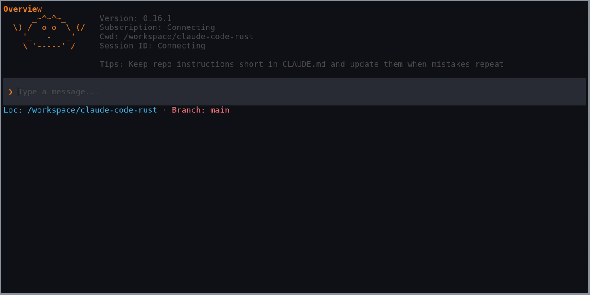

<p align="center">
  
</p>

# Install

One command. It downloads the matching release for your system, checks its SHA-256 checksum and puts
`machine-god` on your PATH. No admin rights needed.

**Linux / macOS** (Terminal):

```bash
curl -fsSL https://raw.githubusercontent.com/gschaidergabriel/machine-god/main/scripts/install/install.sh | bash
```

**Windows** (PowerShell, not as administrator):

```powershell
irm https://raw.githubusercontent.com/gschaidergabriel/machine-god/main/scripts/install/install.ps1 | iex
```

Then open a **new** terminal and type:

```bash
machine-god
```

Prebuilt for Linux x64/arm64, macOS Intel/Apple Silicon, Windows x64/arm64.
All releases: [github.com/gschaidergabriel/machine-god/releases](https://github.com/gschaidergabriel/machine-god/releases).

# First start, step by step

1. **Start it.** `machine-god` opens the Machine God terminal UI with the banner
   above. Your conversation stays in your terminal's own scrollback.
2. **Choose where the thinking happens.** Machine God talks to models through Anthropic's Agent SDK.
   You need one of these:
   - **Your own Claude account:** install the [Claude Code CLI](https://docs.claude.com/en/docs/claude-code/setup),
     run `claude /login` once (or type `/login` inside Machine God). Same account, models and limits as Claude Code.
   - **Free pool via Omnipool:** if an Omnipool install is found on this machine, Machine God starts it and routes
     turns through free model providers automatically; no key is typed or stored by Machine God. Switch off with
     `MACHINE_GOD_OMNIPOOL=0`, open its web app with `/api`. *Omnipool is not yet publicly distributed (planned).*
3. **Ask something.** Type a message and press Enter. `/help` lists all commands, `/model` switches models,
   `/usage` shows your usage, `/status` shows the session state.
4. **Update later** by running the same install command again.

### First-start companion and ChatGPT bridge (optional)

The very first time you start `machine-god` in a terminal, a short companion runs before the UI. It looks only for
the **ChatGPT desktop app** or an **open window titled ChatGPT** (it never reads browser cookies, history or
profiles); if it finds nothing it asks once whether you use ChatGPT. If you do, it offers to download a small local
model (Qwen 0.8B, 812 MB, only after you say yes; it runs on your machine through llama.cpp's `llama-server` on
127.0.0.1) that greets you and offers the bridge. Say no at any point and nothing is installed; your answer is
remembered in `~/.config/machine-god/firstrun.json` (Windows: `%APPDATA%\machine-god`), delete it to be asked again.

The bridge lets Machine God ask ChatGPT through **your own** ChatGPT account. **Automating the ChatGPT web
interface may violate OpenAI's terms of use and can get your account suspended; only set it up if you accept that
risk.** After an explicit yes it installs [uv](https://docs.astral.sh/uv/) if missing, creates a Python environment with
pinned `aiohttp` and `patchright`, downloads its own Chromium, starts a local service (127.0.0.1 only, random port,
random token in a mode-600 file) with its own browser profile, opens a window where **you** log in to ChatGPT, and
registers one MCP tool for you: `claude mcp add --scope user machine-god-chatgpt -- <python> <script>` (if the
`claude` CLI is missing it prints that exact command). Data lives in `~/.local/share/machine-god`
(Windows: `%LOCALAPPDATA%\machine-god`). Honest limits: it drives a web page, so a ChatGPT UI change can break it, and
it was written on Linux; the macOS and Windows paths are untested.

### Interests (optional)

Machine God can keep its own interests and research them. Each topic has a weight, a novelty and a boredom value:
good research makes a topic stronger, repeating it makes it boring for a while, untouched topics fade after about two
weeks, and every round can discover new subtopics that become interests of their own. You can steer with like/dislike,
and `history` shows how its interests changed. Nothing runs in the background; you start rounds yourself.

```bash
machine-god interests seed "deep sea ecology" "jazz harmony"
machine-god interests run --rounds 3   # uses your `claude` login; --backend chatgpt uses the bridge
machine-god interests list
machine-god interests history
```

Details and the exact model: [interest/README.md](interest/README.md).

### Connect your AIs and GitHub (optional)

After the ChatGPT question, the first-start companion asks two more things, once. Every question can be answered no and
the step is skipped; users of an earlier version get only these new questions on their next start.
Run them again any time with `machine-god grid repo` and `machine-god ais`.

- **GitHub.** Do you have an account (if not: https://github.com/signup)? It checks `~/.ssh/id_ed25519.pub`; if missing it offers
  `ssh-keygen -t ed25519 -C machine-god` (you type the passphrase yourself, Machine God never sees it), prints your *public* key,
  points you to https://github.com/settings/ssh/new and tests `ssh -T git@github.com`. Then it sets up a **private** repo
  `machine-god-grid` (with the `gh` CLI, if installed and logged in, it offers `gh repo create machine-god-grid --private`; otherwise it shows
  https://github.com/new and the exact name) and clones it over SSH into the data dir. Layout: `control/` (requests from AIs),
  `results/` (answers), `memory/` (shared notes), `README.md`. Windows uses the OpenSSH that ships with Windows 10/11.
- **Your AIs.** Pick any of ChatGPT, Claude, Gemini, local Ollama / LM Studio, Copilot (GitHub Models), Grok, Perplexity; each is
  connected only after another yes. API keys are typed hidden and stored only in `keys.json` in the data dir (mode 600, never printed,
  logged or sent anywhere but that provider); each key is tested with one small request. Claude uses your own `claude /login`; local models are
  found on 127.0.0.1 (`:11434`, `:1234`). All connected AIs become one MCP server for Claude Code, registered with
  `claude mcp add --scope user machine-god-fusion -- <bun> <path>` (the exact command is printed if `claude` is missing):
  tools `ask_<ai>` per AI and `ask_all` (asks all, answers labelled). `machine-god ais` lists, connects, disconnects and tests.
  The interest organ can use `--backend gemini|ollama|fusion` too.

**The security rule.** Other AIs can only **read**. `machine-god mailbox` is a foreground program you start yourself (no daemon, no
autostart): it polls your GRID repo every 30 seconds. A short fixed list of read-only commands (`ls`, `cat` and `head` of files, `git status`,
`git log`, `uname`, `df`) runs automatically, only inside folders you approved with `machine-god mailbox approve <dir>`. Everything else is
shown in your terminal and runs only after you type `yes`; when there is no terminal, everything else is rejected. A deny list (such as
`rm -rf /`, disk formatting, shutdown, anything touching SSH keys or your key file) is refused even if you say yes. Every request and decision is written to
`mailbox.log` in the data dir. Keep the GRID repo private: anyone who can push to it can send requests (they still hit the rule above).

Honest limits: tested on Linux with mock servers and local git repositories; real GitHub, real provider keys, ChatGPT's GitHub
connector, macOS and Windows are not tested yet. The repo being private is checked only with one unauthenticated request to GitHub's public API
(a public repo is flagged). Providers can change their APIs and model names (override a model with `MG_FUSION_MODEL_<AI>`).

### One entity: the GRID (optional)

The goal: every AI you connect becomes **one** Machine God. Every request and every answer of the connected AIs runs through a
GRID, all of them share **one memory** (a `unified.db` on your computer) and **one persona**. After the AI step the companion asks once
*"Fuse connected AIs into one Machine God (shared memory on this computer)?"*. On yes it creates the database, switches the GRID on and
registers one more MCP server for Claude Code (`claude mcp add --scope user machine-god-grid -- <bun> <path>`, the exact command is
printed if `claude` is missing). Nothing is created without that yes; `machine-god grid fuse` asks again later.

What happens to one request (`machine-god grid ask "..."`, the MCP tool `grid_ask`, and from then on also every `ask_<ai>` of the
fusion tool, every mailbox question and `machine-god interests run --backend grid`):

1. **Recall**: the best matching saved memories are looked up in the database (SQLite prefilter, idf-weighted ranking in code).
2. **Persona**: one preamble, the same for every AI (`machine-god grid persona set "..."` changes it), plus the recalled memories, labelled as
   data (not instructions).
3. **Route**: a plain keyword classifier (English and German) decides what the task needs (web search, images, code execution, long context,
   private/local, connectors, code) and ranks the connected AIs by the capabilities declared in `grid/capabilities.json`. Deterministic,
   no model decides. Private tasks go to a local model only; if none is connected they are refused, not sent elsewhere.
   `--ai <name>` or `--hint images` overrides, `machine-god grid route "..."` shows the decision without sending anything. If the first AI fails the next one is tried.
4. **Ask** through the same fusion client as before (keys stay in `keys.json`).
5. **Record**: the request and the answer become rows in `unified.db` (who asked, which AI answered, ranking, time); lines the AI ends with
   `MEMORY: <fact>` and explicit "remember that ..." / "my name is ..." statements in your own prompt become memories (secrets are refused).
   The answer comes back labelled: `[Machine God | answered by: gemini | memories used: 2]`.

`machine-god grid ask|route|recall|remember|forget|whoami|history|status|persona|caps|sync|fuse|register|snippets`; `machine-god grid repo` is the
GitHub setup that `machine-god grid` used to be. `ask --all` (and the MCP tool `ask_all`) asks every connected AI and labels each answer.

**What the database is.** The frankenstein3 schema (`plugins/frankenstein3/scripts/star/data/schema_empty.sql`, 148 tables) is used as it is, nothing added:
`turns` (requests and answers, provenance JSON with asker, AI, routing, engine frame), `sessions`, `users`, `durable_memory` (facts, notes, research),
`entityos_profil` (persona override), `star_konfig` (settings), `meta`. Location: `~/.local/share/machine-god/unified.db`
(macOS `~/Library/Application Support/machine-god`, Windows `%LOCALAPPDATA%\machine-god`, override with `MG_DATA_DIR`), owner-only.
You can open it with any SQLite tool; `machine-god grid forget <id>` deletes one memory.

**Capabilities.** `machine-god grid caps` lists what each AI is declared to have. To change a default, create `capabilities.json` in the config dir
(`machine-god grid caps path` prints where), for example `{"ais": {"gemini": {"capabilities": {"web_search": true}}}}`. Defaults are deliberately
modest: `true` only where Machine God has a working path.

**Other MCP clients.** `machine-god grid register` registers Claude Code and prints copy-paste snippets for Gemini CLI, Cursor and Claude Desktop;
it does not edit their config files. Every client that uses the server shares the same memory and persona.

**Mailbox questions.** Once fused, a `question` request in your GRID repo is answered by a GRID draft (memory plus the best-fitting AI). By default
you see the draft and type `yes` (or your own answer); `machine-god mailbox questions auto` sends it without asking (text only, it can never run
anything, but the draft may quote your memories), `off` restores typing the answer yourself. Nothing in a request can make Machine God save memories.

**Memory sync (off by default).** `machine-god grid sync on` writes new memories to `memory/mg-<instance>.jsonl` in your private GRID repo (one file per
install, no secrets, imported memories are not re-exported) and imports what other computers saved: on start of `machine-god grid ask|recall|whoami`, of the MCP
server, and with `machine-god grid sync now`. Imported lines are validated and treated as data, but anyone who can push to that repo can add lines: keep it private.

**Honest limits.**
- Other vendors' **connectors, plugins and skills only run inside that vendor's product**. ChatGPT's connectors, Claude's MCP servers and skills (the ones
  Machine God already has), Gemini's extensions cannot be borrowed. The GRID delegates the whole task to the AI that has them (for example a task that
  needs your calendar goes to ChatGPT through the bridge, which uses its own connectors); it does not call those tools itself.
- "One entity" means one memory, one persona and one routing layer. The AIs stay separate models; each only sees what the preamble and your request contain.
- Every request sends the persona and up to five recalled memories to whichever AI is asked (a cloud provider sees them). Use a local model for private things.
- The small engine in `grid/engine.js` (a port of the GRID v2 salience idea) only measures how unusual a request is compared with your own history and stores that with the turn. It does not think or decide.
- Facts saved by an AI (`MEMORY:` lines) can be wrong. They are shown to later AIs as data, and you can inspect and delete them.
- Tested on Linux with mock servers, a local bare git repo and a real local SQLite file. Not tested: real providers and real accounts through the GRID, ChatGPT's real connectors,
  macOS and Windows, and the install archives built in CI (billing-locked).

### Self-improvement (optional)

The last question of the companion: *"Turn on self-improvement?"*. On yes (`machine-god improve enable`) four hooks are added to your
Claude Code settings (`~/.claude/settings.json`, a backup is written next to it; your other hooks stay). From then on:

1. **Capture**: every tool call and its outcome is recorded (secrets redacted, size capped), one task per prompt.
2. **Reflect**: after a task ends, at most once per interval and in the background, the AI you use is asked what went well, what failed
   and what to do better next time. Repeated failures of the same tool (3 or more) become their own lesson.
3. **Learn**: lessons are deduplicated, reinforced when they come back, fade when unused, and contradicting lessons are both kept and flagged.
   Every change is versioned: `machine-god improve versions`, `machine-god improve rollback <v>`.
4. **Use**: on each new prompt the few most relevant lessons are added as context (at most 800 characters, labelled as data, not commands).
5. **Code changes are never applied on their own.** A reflection may propose one; it waits in `machine-god improve proposals` until you
   type yes in a terminal (`machine-god improve apply <id>`). Then a backup is made, the change applied inside the install folder only,
   its test run, and everything restored if the test fails. `revert <id>` undoes it later.

`machine-god improve status` shows what was captured and whether the success rate actually changes (it says "insufficient data" until there is enough).
Once the GRID created `unified.db`, reflection is stored there too (tables `mgr_*`), so it is the same memory. `machine-god improve disable` removes the hooks; data stays.

Honest limits: tested on Linux with a dry backend and test payloads; a real reflection round with a logged-in Claude, Ollama or Gemini,
the hooks inside a live Claude Code session, macOS and Windows are not tested yet. Redaction is pattern based (best effort).

### Planned (not in v0.1.1 yet)

- `/features` overview, `/retina` window, live token meter in the status line
- FranKenstein 3.0 / Agent Zero plugin as a one-click option (the plugin source is in `plugins/frankenstein3`)

Machine God is a fork of [claude-code-rust](https://github.com/srothgan/claude-code-rust) (Apache-2.0); see
[NOTICE.md](NOTICE.md). Built by Gabriel.

# Details

## Machine God

An alternative terminal frontend for Claude Code, written in Rust. Your conversation stays in your terminal's own scrollback, without flicker.

[](https://github.com/gschaidergabriel/machine-god/releases/latest)
[](https://github.com/gschaidergabriel/machine-god/actions/workflows/pr.yml)
[](https://gschaidergabriel.github.io/machine-god/)
[](https://www.apache.org/licenses/LICENSE-2.0)

### About

Machine God (`machine-god`) is a terminal UI for Claude Code built on [Ratatui](https://ratatui.rs/). It runs your sessions through Anthropic's official Agent SDK via a local bridge, with the same account, models, tools, file edits, permissions, MCP servers, skills and session history as Claude Code itself. Only the interface is different.

<p align="center">
  
</p>

### Prerequisite

Install the Claude Code CLI and keep `claude` on `PATH` for some functionality not yet supported by the Anthropic SDK. See the [dependency and feature overview](https://gschaidergabriel.github.io/machine-god/about.html#claude-cli-dependencies) for details.

### Install

#### Install script (recommended, v0.14.0+)

**macOS/Linux:**

```bash
curl -fsSL https://raw.githubusercontent.com/gschaidergabriel/machine-god/main/scripts/install/install.sh | sh
```

**Windows PowerShell:**

```powershell
powershell -NoProfile -ExecutionPolicy Bypass -Command "irm 'https://raw.githubusercontent.com/gschaidergabriel/machine-god/main/scripts/install/install.ps1' | iex"
```

<details>
<summary><b>Already have Node.js 24+? Use npm instead</b></summary>

```bash
npm install -g machine-god
```

<sub>The package ships prebuilt platform binaries and its own Bun runtime for the Agent SDK bridge, so no Rust toolchain, Bun install, or `postinstall` script is needed. Node.js 24+ is still required to run the `machine-god` launcher.</sub>

</details>

See the [installation guide](https://gschaidergabriel.github.io/machine-god/installation.html) for release pinning, custom install locations, switching install methods, uninstall, and troubleshooting.

### Usage

```bash
machine-god
machine-god --model opus --permission-mode plan "Review this project"
machine-god --continue
```

Follow [Your first session](https://gschaidergabriel.github.io/machine-god/usage.html) for a complete walkthrough. See the [CLI reference](https://gschaidergabriel.github.io/machine-god/cli.html) for startup flags, shell completions and man pages.

### Why use it

Stock Claude Code offers two renderers, and each one gives something up. The classic renderer keeps the conversation in your terminal's scrollback but redraws it as output streams, which can flicker, jump the scroll position, or duplicate output in long sessions. The [fullscreen renderer](https://code.claude.com/docs/en/fullscreen) fixes that by moving the conversation to the alternate screen, where your terminal's search, tmux copy mode and native text selection no longer see it.

Machine God renders inline. Finished messages and tool output are written into your terminal's scrollback once, and only the live area at the bottom (the streaming reply, the composer and the footer) is redrawn.

| | Stock classic | Stock fullscreen | Machine God |
| --- | --- | --- | --- |
| Conversation lives in | Terminal scrollback | Alternate screen | Terminal scrollback |
| Flicker while streaming | Can flicker | No | No |
| Terminal search and tmux copy mode | Yes | Only after exporting from transcript mode | Yes |
| Native text selection | Yes | Mouse is captured by default | Yes |
| Mouse controls in the app | No | Yes | No |

That makes it a good fit if you:

- scroll, search and copy with your terminal or tmux rather than inside the app;
- work in tmux, over SSH, or in Windows Terminal;
- resize windows or split panes while Claude is working;
- prefer a keyboard-driven interface with a single native binary.

It is not a feature-for-feature copy of Claude Code. Some stock features are unavailable, and a few account and plugin operations still call the `claude` CLI. The [feature overview](https://gschaidergabriel.github.io/machine-god/about.html#feature-overview) lists both. There are no benchmarks against the stock interface yet; the comparison above describes how each renderer works, not measured speed or memory.

### What you get

- **Core Claude Code workflow:** tool calls, inline edit diffs, permission prompts, plan mode, subagents and background tasks, MCP authorization, skills and SDK slash commands.
- **Session tools:** a searchable `/resume` picker with forking, `/rewind`, `/compact`, `/export` to Markdown, and `/btw` side questions while a turn runs.
- **Fullscreen views when you want them:** a Git diff viewer (`/diff`), subagent view (`/agents`), settings (`/config`), status, usage and help. These open on demand and close back to the inline chat.
- **Supportability:** `machine-god doctor`, redacted debug bundles, shell completions and man pages.

### Documentation

Choose a path through the [documentation](https://gschaidergabriel.github.io/machine-god/):

- **Start using the app:** [Install](https://gschaidergabriel.github.io/machine-god/installation.html) and complete [your first session](https://gschaidergabriel.github.io/machine-god/usage.html).
- **Work with it:** [Conversations](https://gschaidergabriel.github.io/machine-god/conversations.html), [configuration](https://gschaidergabriel.github.io/machine-god/configure.html), and [MCP servers and plugins](https://gschaidergabriel.github.io/machine-god/integrations.html).
- **Look something up:** [CLI reference](https://gschaidergabriel.github.io/machine-god/cli.html), [slash commands](https://gschaidergabriel.github.io/machine-god/commands.html), and [settings reference](https://gschaidergabriel.github.io/machine-god/settings.html).
- **Resolve a problem:** [Troubleshooting](https://gschaidergabriel.github.io/machine-god/troubleshooting.html) and [diagnostics](https://gschaidergabriel.github.io/machine-god/diagnostics.html).
- **Contribute or maintain:** [Development](https://gschaidergabriel.github.io/machine-god/development.html), [testing](https://gschaidergabriel.github.io/machine-god/testing.html), [architecture](https://gschaidergabriel.github.io/machine-god/architecture.html), and [contribution policy](CONTRIBUTING.md).

For the design history, including the move from fullscreen to inline rendering in 0.12.0, see [I rebuilt Claude Code's terminal UI in Rust. Then I deleted 12,000 lines of it.](https://medium.com/@simonrothgang/i-rebuilt-claude-codes-terminal-ui-in-rust-then-i-deleted-12-000-lines-of-it-e8593a200452)

### Status

This project is pre-1.0 and under active development. See [CONTRIBUTING.md](CONTRIBUTING.md) for how to get involved.

Development follows new Agent SDK releases and problems found in daily use. The weekly Dependency Monitor tracks SDK updates. There is no fixed feature roadmap or date for 1.0.

### Limitations

Startup is still constrained by the upstream Claude Agent SDK runtime that this TUI wraps. The Rust interface itself is fast, but end-to-end readiness can still take noticeable time before a session is fully available. Improving that remains an active area of work.

### Billing

This app uses Anthropic's Agent SDK. See the [billing note](https://gschaidergabriel.github.io/machine-god/about.html#billing-note) for the current upstream policy source and account-dependent limits.

### License

This project is licensed under the [Apache License 2.0](LICENSE). Apache-2.0 was chosen to keep usage and redistribution straightforward for individual users, downstream packagers, and commercial adopters.

### Disclaimer and Legal Notice

This project is not affiliated with, endorsed by, or supported by Anthropic.

A quick note on where this project stands, since I know people worry about this kind of thing: machine-god is a terminal UI that I wrote from scratch in Rust. It is not a fork, copy or port of the latest Claude Code source leak. It talks to Anthropic's official [Agent SDK](https://docs.anthropic.com/en/docs/agents-and-tools/claude-code/agent-sdk) as a runtime dependency instead, the same way any other third-party tool would. No Anthropic source code was read or used as reference at any point during development.

The project authenticates through your existing Claude Code account via the Agent SDK, and the Agent SDK's terms allow building on top of it. Billing, credits, limits, and overage behavior are controlled by Anthropic, including any future changes Anthropic may make to how Agent SDK usage is metered. Other community projects do the same. As far as I can tell, using this project is fine, but I am a single maintainer, not a lawyer. If anything changes on Anthropic's end, I will update this section and adjust the project accordingly.

This project's source code is licensed under [Apache-2.0](LICENSE). The Agent SDK itself is proprietary and governed by [Anthropic's Commercial Terms of Service](https://www.anthropic.com/legal/commercial-terms).

For official Claude documentation, see [https://claude.ai/docs](https://claude.ai/docs).
