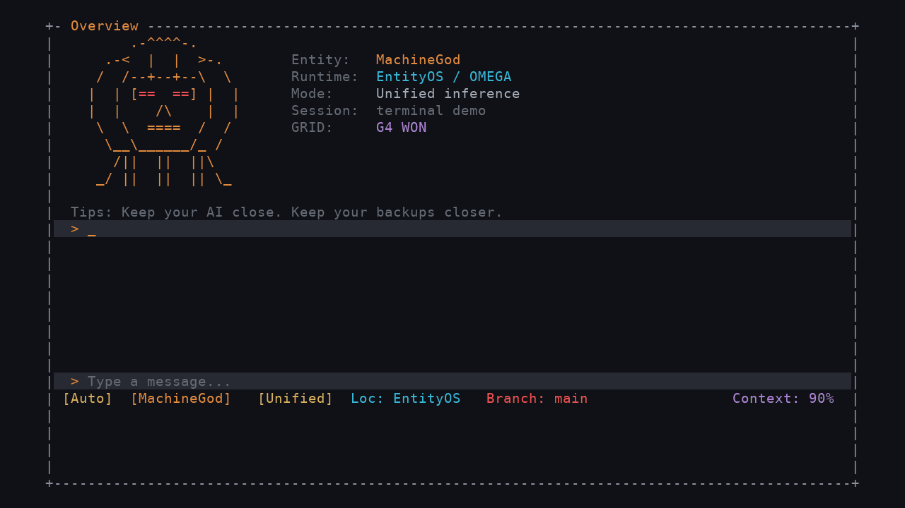
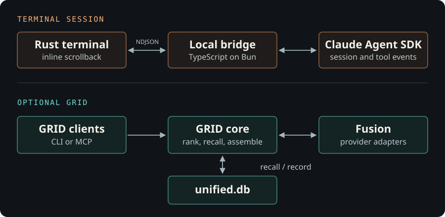
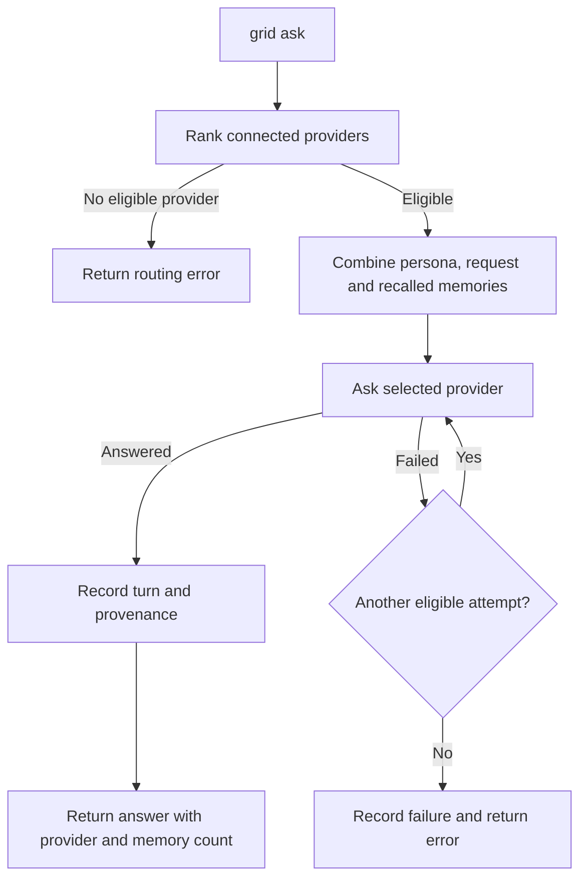

# Machine God

A Rust terminal for Claude Code with an optional multi-model GRID. Finished replies and tool output stay in your terminal’s scrollback. With GRID enabled, a later request can recall a decision from an earlier turn, even when a different model answers.



[Install](#install) · [GRID](#what-is-the-grid) · [Omnipool](#what-is-omnipool) · [Terminal demo](assets/demo.gif) · [Build from source](docs/src/development.md) · [Research archive](docs/research-archive.md)

## Install

The installers fetch a platform archive and verify its SHA-256 against the release checksums. Check the [release assets](https://github.com/gschaidergabriel/machine-god/releases) for your platform. For a checkout, use the [source build instructions](docs/src/development.md).

**Linux or macOS**

```sh
curl -fsSL https://raw.githubusercontent.com/gschaidergabriel/machine-god/main/scripts/install/install.sh | sh
```

**Windows PowerShell**

```powershell
irm https://raw.githubusercontent.com/gschaidergabriel/machine-god/main/scripts/install/install.ps1 | iex
```

Open a new terminal in the project you want to work on and run `machine-god`. For the Claude workflow, install the Claude Code CLI and sign in with `/login`. The first-start companion offers optional integrations. You can skip them and start a terminal session.

Ask **“Which file starts this application?”** As the reply streams, scroll back or search with your terminal. Type `/diff` to inspect edits or `/resume` to reopen a conversation. If startup stalls, run `machine-god doctor`. [First session](docs/src/usage.md) · [Install options](docs/src/installation.md) · [Troubleshooting](docs/src/troubleshooting.md)

## Inside the runtime



The terminal commits completed output to scrollback and redraws the active reply and composer. Its local bridge carries session and tool events. GRID has its own entry points, including the CLI and an MCP server. [Terminal architecture](docs/src/architecture.md) · [GRID entry points](grid/cli.js) · [MCP tools](grid/mcp_grid.js)

## What is the GRID?

The GRID gives connected models a common working memory. Suppose you tell one model that release builds use an amber theme. When you later ask another model about the release, GRID can retrieve that note from local SQLite, add it to the shared persona and prompt, and record which provider answered. You can inspect the stored note, change the persona or forget a memory. Models retain their own weights and capabilities.

Each request also produces a **salience frame**. The engine compares signal changes against a slowly adapting baseline and can abstain when the change is too small. The current request adapter supplies five of ten cells: G6 detects code cues, G7 marks a request, G8 counts memory hits, G9 measures novelty against recent prompts, and G10 measures prompt length. G1–G5 currently receive zero from this adapter. **“G4 WON” in the GIF is scripted artwork.** The capability router independently decides which connected provider to ask.

<details>
<summary>See three measured frames from the salience engine</summary>

A fresh engine received these prompts in order, with zero memory hits and the earlier prompts as its comparison history. The first observation establishes a baseline. Repeating “hello” then moves novelty from 1 to 0. The word `git` in the third input activates the code signal.

| Input | Code signal G6 | Novelty G9 | Engine result |
| --- | ---: | ---: | --- |
| `hello` | 0 | 1 | Abstain (baseline) |
| `hello` | 0 | 0 | G9 |
| `git diff` | 1 | 1 | G6 |

The engine scores changes in either direction. A novelty-cell win on the second row means the input became *less* novel. You can reproduce the sequence with `signalsFor` and `Engine.step` in [the engine source](grid/engine.js).

</details>

### Follow a GRID request

GRID opens existing German databases in place (`entityos_profil`, `star_konfig`). It also supports the English names shipped in the install archive. Both layouts retain their original data and identifiers.

After connecting a provider with `machine-god ais` and enabling shared memory with `machine-god grid fuse`, try this short session. Only the final command asks a provider.

```sh
machine-god grid remember "Release builds use the amber theme."
machine-god grid recall "release theme"
machine-god grid route "Which theme do release builds use?"
machine-god grid ask "Which theme do release builds use?"
```



`grid route` previews the ranking without sending a prompt. Automatic routing uses declared capabilities and English/German keyword rules. A cloud provider selected for an answer receives the request, persona and recalled context. Explicit `--ai` selection and `--all` fan-out have different routing behavior. [Routing rules](grid/capabilities.js) · [Request handling](grid/core.js) · [Salience engine](grid/engine.js)

## What is Omnipool?

Omnipool (API-OMNI-BRAIN) is a local gateway to model providers. It gives a client one endpoint for the free-tier models configured on that machine. It classifies a request, probes model capabilities and uses past successes and failures to choose a candidate. For example, a model that reliably returns valid JSON can earn more structured-output traffic. Availability depends on the configured providers and their current quotas.

Machine God looks for an existing Omnipool installation when the SDK bridge starts. If it finds the configuration, it can start the daemon and point the bridge at the local endpoint (default `127.0.0.1:8799`). The gateway may then call a remote provider. Type `/api` to open its dashboard, or set `MACHINE_GOD_OMNIPOOL=0` before launch to use the ordinary SDK configuration.

| Component | Decision it owns |
| --- | --- |
| GRID | Which connected AI should handle this task, and which memories should accompany it? |
| Omnipool | Which available model in this installation’s pool should serve an incoming gateway request? |

[Omnipool project and setup](https://github.com/gschaidergabriel/API-OMNI-BRAIN) · [Machine God integration](src/omnipool.rs) · [Bridge startup](src/agent/bridge.rs)

## Explore the system

| What you want to do | Where to start |
| --- | --- |
| Review a patch, resume a session or export a conversation | [Conversation tools](docs/src/conversations.md) and [slash commands](docs/src/commands.md) |
| Share a persona and inspect which memories informed a reply | [GRID setup, provenance and SQLite storage](docs/connected-systems.md#one-entity-the-grid-optional) |
| Ask several connected models the same question | [Fusion and provider setup](docs/connected-systems.md#connect-your-ais-and-github-optional) |
| Let a topic evolve across research rounds | [Interest weights, novelty and boredom](interest/README.md) |
| Inspect learned lessons, proposed edits and rollback | [Reflection hooks and proposal review](reflect/README.md) |
| Review a remote request before allowing local actions | [Private repository and foreground mailbox](docs/connected-systems.md#connect-your-ais-and-github-optional) |
| Audit the FranKenstein / Agent Zero research | [Original research papers](docs/research-archive.md), [capability status](docs/zero/status.md), [evidence ledger](docs/zero/evidence_ledger.md) and [plugin source](plugins/frankenstein3) |

## Evidence and limits

The terminal animation is a scripted vignette. The separate [terminal recording](assets/demo.gif) has a [reproducible recording setup](recordings/README.md). For implementation evidence, the [GRID tests](grid/grid.test.js) exercise routing and storage, and the [reflection tests](reflect/reflect.test.ts) cover lessons and proposals. The project documents Linux fixture coverage and outstanding verification with live accounts and other operating systems in [Connected systems](docs/connected-systems.md).


Machine God is Gabriel’s fork of [claude-code-rust](https://github.com/srothgan/claude-code-rust) by srothgan. The terminal uses Anthropic’s Agent SDK. Machine God is an independent project. [Attribution](NOTICE.md) · [Apache-2.0 license](LICENSE) · [Contributing](CONTRIBUTING.md) · [Security](SECURITY.md)
